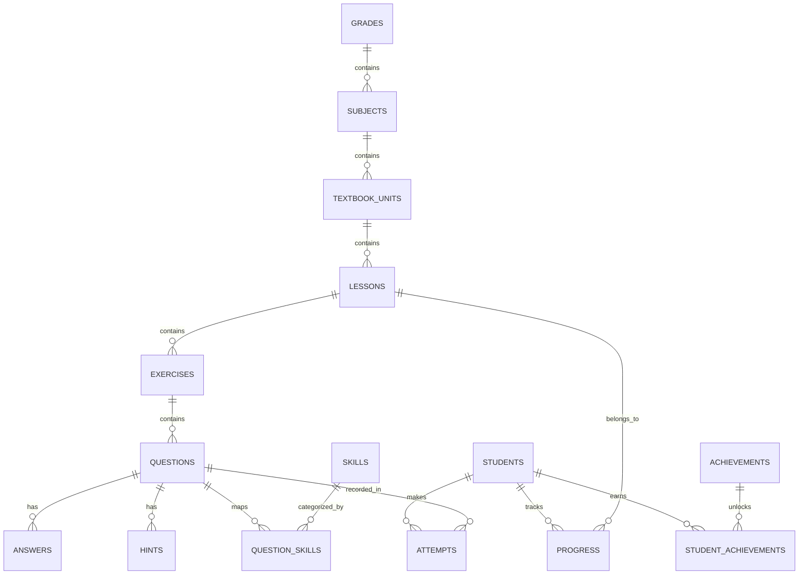
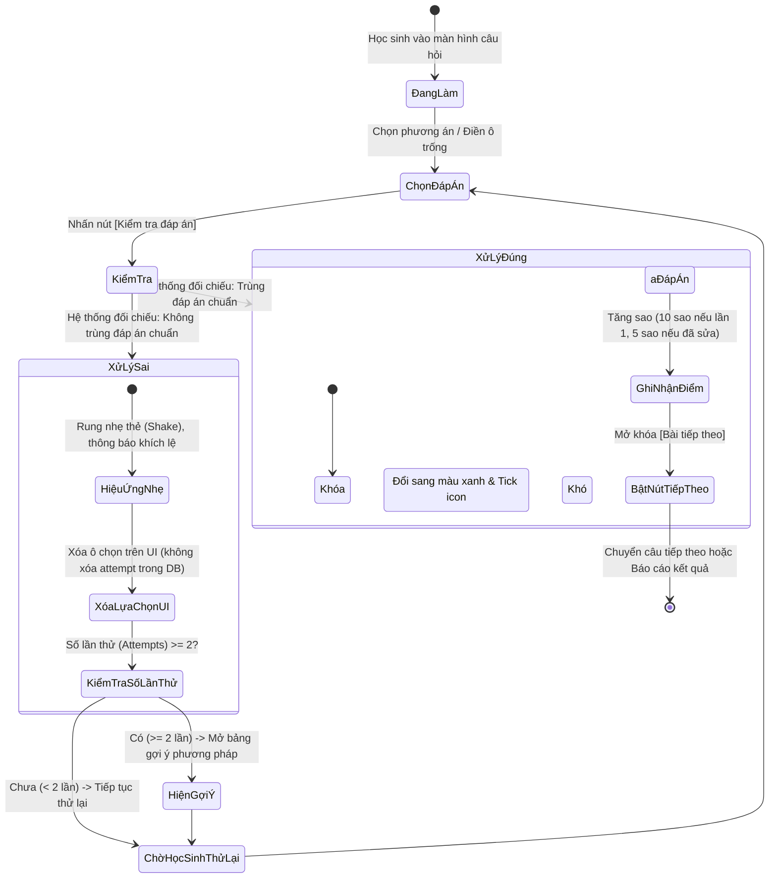
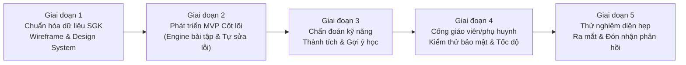

# BẢN THIẾT KẾ KIẾN TRÚC VÀ KẾ HOẠCH THỰC THI CHI TIẾT

## DỰ ÁN: LEARNCHILL (TOÁN – TIẾNG VIỆT – TIẾNG ANH) – HỌC VUI MỖI NGÀY

_(Nền tảng học tập tương tác Tiểu học bám sát SGK Kết nối tri thức với cuộc sống)_

---

## 1. TỔNG QUAN VÀ ĐÁNH GIÁ ĐỊNH HƯỚNG DỰ ÁN

Bản đề xuất **LearnChill: Toán – Tiếng Việt – Tiếng Anh (Học vui mỗi ngày)** thể hiện tư duy thiết kế sản phẩm giáo dục (EdTech) rất chín chắn, bám sát tâm lý học sư phạm lứa tuổi 8–11 (học sinh lớp 3, 4, 5) với các điểm cốt lõi vượt trội:

1. **Tư duy phát triển (Growth Mindset)**: Thay vì chấm điểm phạt hay tạo áp lực xếp hạng (Leaderboard) làm học sinh tự ti, hệ thống tôn vinh sự kiên trì ("Đúng ngay lần đầu" và "Sửa đúng sau khi kiên trì").
2. **Cơ chế sửa sai thông minh (Soft Correction Loop)**: Không đưa đáp án ngay khi sai; xóa ô chọn trên màn hình nhưng lưu vết dữ liệu hệ thống, kích hoạt gợi ý phương pháp ở lần thử thứ 2.
3. **Tuân thủ pháp lý & Bảo vệ dữ liệu trẻ em**: Đón đầu **Luật Bảo vệ dữ liệu cá nhân số 91/2025/QH15** (hiệu lực từ 01/01/2026), hạn chế tối đa việc thu thập thông tin định danh cá nhân nhạy cảm của trẻ.
4. **Tiếp cận toàn diện (WCAG 2.2)**: Ưu tiên kích thước điểm chạm ngón tay 48–56px, cơ chế "chạm 2 điểm" (Two-tap pairing) thay vì kéo thả (drag-and-drop) phức tạp trên màn hình cảm ứng di động.

---

## 2. KIẾN TRÚC CƠ SỞ DỮ LIỆU CHI TIẾT (SUPABASE / POSTGRESQL)

Để đảm bảo nội dung không bị "hardcode" (viết chết vào mã nguồn) và có thể quản lý, mở rộng linh hoạt theo từng bài học SGK, hệ thống sử dụng mô hình cơ sở dữ liệu quan hệ chuẩn hóa:



### 2.1. Chi tiết các bảng nghiệp vụ cốt lõi

```sql
-- 1. Khối lớp (3, 4, 5)
CREATE TABLE grades (
    id SERIAL PRIMARY KEY,
    name VARCHAR(20) NOT NULL, -- Lớp 3, Lớp 4, Lớp 5
    level INT NOT NULL UNIQUE,
    color_code VARCHAR(7) DEFAULT '#FFC85A',
    icon_url TEXT
);

-- 2. Môn học (Toán, Tiếng Việt, Tiếng Anh)
CREATE TABLE subjects (
    id SERIAL PRIMARY KEY,
    grade_id INT REFERENCES grades(id) ON DELETE CASCADE,
    code VARCHAR(30) NOT NULL, -- 'math', 'vietnamese', 'english'
    title VARCHAR(100) NOT NULL,
    theme_color VARCHAR(7) NOT NULL, -- #62C9F3 (Toán), #FF91A8 (Tiếng Việt), #78D9AE (Tiếng Anh)
    icon TEXT,
    created_at TIMESTAMPTZ DEFAULT NOW()
);

-- 3. Chủ đề / Chương theo SGK Kết nối tri thức
CREATE TABLE textbook_units (
    id SERIAL PRIMARY KEY,
    subject_id INT REFERENCES subjects(id) ON DELETE CASCADE,
    semester INT CHECK (semester IN (1, 2)),
    unit_order INT NOT NULL,
    title VARCHAR(255) NOT NULL, -- Ví dụ: "Chủ đề 1: Ôn tập và bổ sung"
    description TEXT
);

-- 4. Bài học SGK
CREATE TABLE lessons (
    id SERIAL PRIMARY KEY,
    unit_id INT REFERENCES textbook_units(id) ON DELETE CASCADE,
    lesson_order INT NOT NULL,
    title VARCHAR(255) NOT NULL, -- Ví dụ: "Bài 02: Ôn tập phép cộng, phép trừ trong phạm vi 1000"
    estimated_minutes INT DEFAULT 15,
    is_active BOOLEAN DEFAULT TRUE
);

-- 5. Bài tập trong bài học
CREATE TABLE exercises (
    id SERIAL PRIMARY KEY,
    lesson_id INT REFERENCES lessons(id) ON DELETE CASCADE,
    exercise_order INT NOT NULL,
    title VARCHAR(255) NOT NULL,
    pass_score_percentage INT DEFAULT 100 -- Yêu cầu 100% đúng mới mở bài tiếp theo
);

-- 6. Danh mục kỹ năng đánh giá (Dùng cho trang phản hồi & phát hiện điểm yếu)
CREATE TABLE skills (
    id SERIAL PRIMARY KEY,
    subject_id INT REFERENCES subjects(id),
    skill_code VARCHAR(50) UNIQUE NOT NULL,
    name VARCHAR(255) NOT NULL, -- VD: "Cộng nhẩm phạm vi 1000", "Đọc hiểu đề toán có lời văn"
    advice_template TEXT -- Hướng dẫn rèn luyện mẫu cho học sinh
);

-- 7. Ngân hàng câu hỏi tương tác
CREATE TABLE questions (
    id SERIAL PRIMARY KEY,
    exercise_id INT REFERENCES exercises(id) ON DELETE CASCADE,
    question_type VARCHAR(30) NOT NULL, -- 'choice', 'match', 'fill_blank', 'true_false', 'sort'
    content TEXT NOT NULL,
    illustration_url TEXT,
    difficulty_level INT DEFAULT 1,
    points INT DEFAULT 10,
    created_at TIMESTAMPTZ DEFAULT NOW()
);

-- 8. Kỹ năng gắn với câu hỏi (1 câu có thể kiểm tra 1 hoặc nhiều kỹ năng)
CREATE TABLE question_skills (
    question_id INT REFERENCES questions(id) ON DELETE CASCADE,
    skill_id INT REFERENCES skills(id) ON DELETE CASCADE,
    PRIMARY KEY (question_id, skill_id)
);

-- 9. Đáp án & phương án trả lời
CREATE TABLE answers (
    id SERIAL PRIMARY KEY,
    question_id INT REFERENCES questions(id) ON DELETE CASCADE,
    option_key VARCHAR(10), -- 'A', 'B', 'C', 'D' hoặc ID cặp ghép
    content TEXT NOT NULL,
    is_correct BOOLEAN NOT NULL DEFAULT FALSE,
    match_pair_id VARCHAR(50) -- Khóa ghép nối nếu là dạng bài 'match'
);

-- 10. Gợi ý thông minh (Kích hoạt khi học sinh sai từ lần 2)
CREATE TABLE hints (
    id SERIAL PRIMARY KEY,
    question_id INT REFERENCES questions(id) ON DELETE CASCADE,
    hint_level INT DEFAULT 1, -- Level 1: Nhắc lại công thức/từ khóa; Level 2: Các bước giải
    content TEXT NOT NULL
);

-- 11. Tài khoản học sinh (Tuân thủ bảo vệ dữ liệu trẻ em)
CREATE TABLE students (
    id UUID PRIMARY KEY DEFAULT gen_random_uuid(),
    student_code VARCHAR(50) UNIQUE NOT NULL, -- Mã học sinh thay vì email định danh
    nickname VARCHAR(50) NOT NULL,
    avatar_id VARCHAR(50) DEFAULT 'owl_smart',
    grade_id INT REFERENCES grades(id),
    parent_consent BOOLEAN DEFAULT TRUE,
    created_at TIMESTAMPTZ DEFAULT NOW()
);

-- 12. Lịch sử làm bài và theo dõi số lần thử (Audit log chi tiết)
CREATE TABLE attempts (
    id BIGSERIAL PRIMARY KEY,
    student_id UUID REFERENCES students(id) ON DELETE CASCADE,
    question_id INT REFERENCES questions(id) ON DELETE CASCADE,
    attempt_number INT NOT NULL DEFAULT 1,
    submitted_answer TEXT NOT NULL,
    is_correct BOOLEAN NOT NULL,
    hints_viewed INT DEFAULT 0,
    time_spent_seconds INT,
    created_at TIMESTAMPTZ DEFAULT NOW()
);

-- 13. Tiến độ học tập của học sinh
CREATE TABLE progress (
    id BIGSERIAL PRIMARY KEY,
    student_id UUID REFERENCES students(id) ON DELETE CASCADE,
    lesson_id INT REFERENCES lessons(id) ON DELETE CASCADE,
    is_completed BOOLEAN DEFAULT FALSE,
    first_try_correct_count INT DEFAULT 0,
    corrected_count INT DEFAULT 0,
    total_stars_earned INT DEFAULT 0,
    completed_at TIMESTAMPTZ,
    UNIQUE (student_id, lesson_id)
);
```

---

## 3. CƠ CHẾ VẬN HÀNH NGHIỆP VỤ PHÒNG LUYỆN TẬP (INTERACTION STATE MACHINE)



---

## 4. QUY CHUẨN THIẾT KẾ UX/UI CHO TRẺ EM (WCAG 2.2 & CLAYMORPHISM)

| Thành phần                       | Tiêu chuẩn kỹ thuật                                                                                                                                            | Mục đích trải nghiệm trẻ em                                                                                |
| :------------------------------- | :------------------------------------------------------------------------------------------------------------------------------------------------------------- | :--------------------------------------------------------------------------------------------------------- |
| **Bảng màu chủ đạo**             | `#62C9F3` (Toán - Sky Blue)<br>`#FF91A8` (Tiếng Việt - Peach)<br>`#78D9AE` (Tiếng Anh - Mint)<br>`#FFC85A` (Điểm thưởng - Sunny)<br>`#FFF7E8` (Nền Milk Cream) | Tone màu tươi vui, ấm áp, không gây chói mắt hay căng thẳng thị giác (Eye Strain).                         |
| **Kích thước nút bấm**           | Cao **52px – 56px**, bo góc `rounded-2xl` (16–20px)                                                                                                            | Vùng chạm lớn (Target Size) vượt chuẩn tối thiểu 24px của WCAG 2.2 SC 2.5.8, phù hợp với ngón tay trẻ nhỏ. |
| **Cảm giác nhấn (Haptic Touch)** | Đổ bóng nổi `shadow-[0_6px_0_#...]`, khi active trượt xuống `translate-y-1`                                                                                    | Trẻ có phản hồi xúc giác thị giác (Tactile feedback) rõ ràng khi bấm nút.                                  |
| **Font chữ & Tương phản**        | Cỡ chữ câu hỏi 18–22px, chữ hướng dẫn 15–17px; Chữ màu Slate Navy (`#1E293B`) trên nền sáng                                                                    | Đạt tỷ lệ tương phản > 4.5:1 (WCAG AA), không dùng chữ trắng trên nền vàng hoặc hồng nhạt.                 |
| **Xử lý ghép nối (Matching)**    | Chế độ chạm chọn lần lượt 2 đối tượng (Tap Item A -> Tap Item B)                                                                                               | Không ép buộc thao tác rê/kéo (Drag-and-drop) dễ tuột tay trên màn hình điện thoại cảm ứng.                |

---

## 5. BẢO MẬT VÀ BẢO VỆ DỮ LIỆU HỌC SINH THEO PHÁP LUẬT VIỆT NAM

Căn cứ **Luật Bảo vệ dữ liệu cá nhân số 91/2025/QH15** (có hiệu lực từ ngày 01/01/2026), dự án áp dụng các nguyên tắc bắt buộc:

1. **Nguyên tắc giảm thiểu dữ liệu (Data Minimization)**:
   - Học sinh không đăng ký bằng số điện thoại hay số CCCD/định danh cá nhân.
   - Sử dụng định danh nội bộ: `Mã học sinh` do trường hoặc phụ huynh tạo + `Biệt danh thân mật` (ví dụ: `Bảo Nam`, `Minh Khôi`).
2. **Sự đồng ý của người đại diện (Parental Consent)**:
   - Quy trình tạo tài khoản phải thông qua cổng xác nhận của phụ huynh/giáo viên.
3. **Môi trường số lành mạnh cho trẻ em**:
   - Hoàn toàn **không tích hợp mạng quảng cáo hướng đối tượng (Targeted Ad Networks)** hay mã theo dõi của bên thứ ba (Third-party tracking cookies).
   - Không công khai dữ liệu kết quả học tập ra bên ngoài hoặc trên công cụ tìm kiếm Google (`robots.txt` chặn lập chỉ mục các route `/bai-hoc/*`, `/thanh-tich/*`, `/ho-so/*`).
   - Không xây dựng bảng xếp hạng ganh đua tiêu cực (Public Leaderboard).

---

## 6. LỘ TRÌNH 5 GIAI ĐOẠN TRIỂN KHAI THỰC TẾ



### Chi tiết hành động ưu tiên ngay cho Giai đoạn 1 & 2:

1. **Kiểm tra và chuẩn hóa nguồn SGK**:
   - Đối chiếu danh mục bài học môn Toán, Tiếng Việt, Tiếng Anh lớp 3, 4, 5 theo bản in chính thức của NXB Giáo dục Việt Nam (Bộ sách Kết nối tri thức).
   - Lập ma trận gắn mã kỹ năng (`skill_code`) cho từng dạng câu hỏi (Ví dụ: `MATH_G3_ADD_1000`, `VIET_G3_WORD_NOUN`, `ENG_G3_VOCAB_FAMILY`).
2. **Xây dựng khung giao diện chuẩn (Design System)**:
   - Sử dụng Tailwind CSS với các token màu và component chuẩn hóa đã mô phỏng trong bản Prototype.
3. **Lập trình lõi tương tác (Interaction Engine)**:
   - Triển khai máy trạng thái câu hỏi, đảm bảo câu đúng bị khóa, câu sai bị xóa lựa chọn trên UI nhưng lưu vết log `attempts` vào cơ sở dữ liệu.
